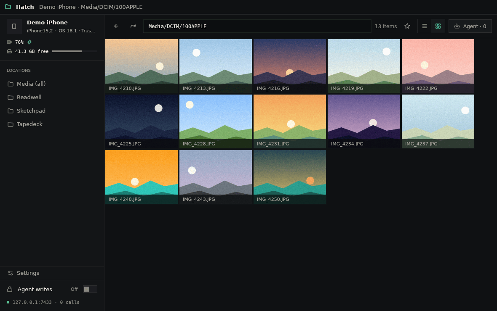
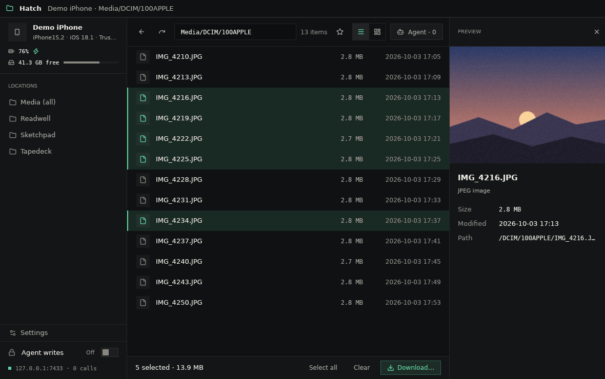
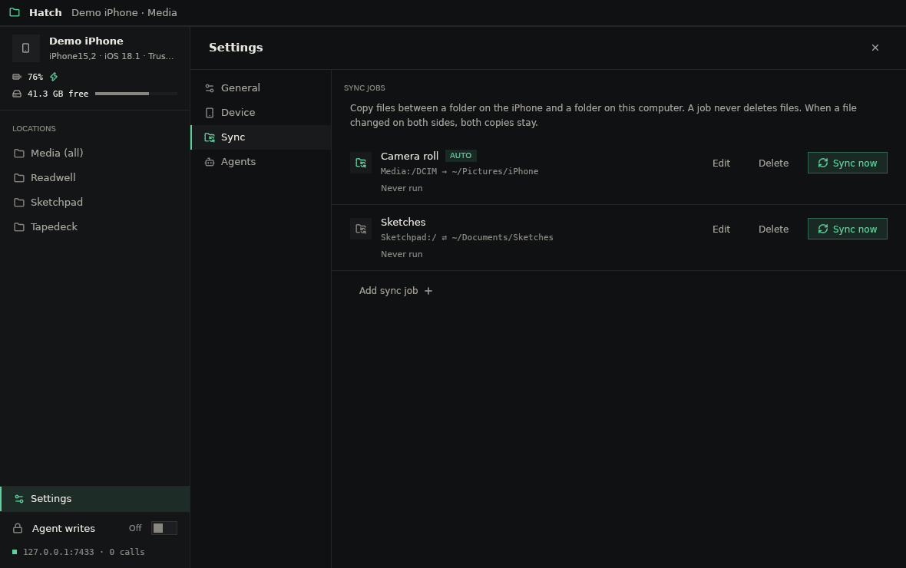
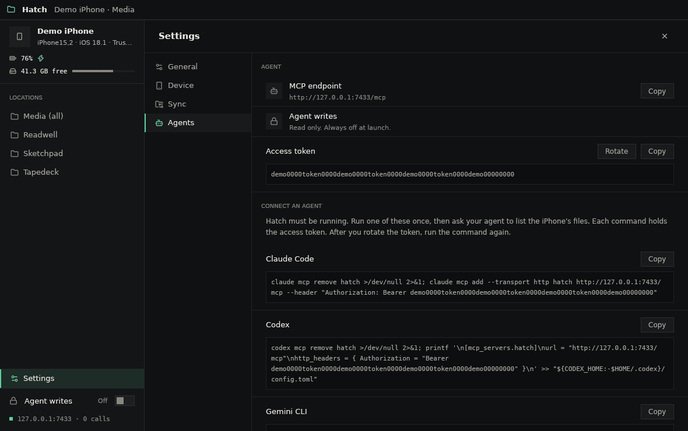

# Hatch

Browse an iPhone's files over USB. Let an AI agent do the same through MCP.

Hatch is a Linux desktop app. It uses Rust, [gpui-kit](https://gpui-kit.com), and the [idevice](https://crates.io/crates/idevice) crate.



## Run

You need `usbmuxd` and an iPhone connected by USB.

```sh
cargo run
```

The first time, the iPhone must trust this computer:

1. Unlock the iPhone.
2. Click **Trust this computer** in the Hatch sidebar.
3. On the iPhone, tap **Trust**.
4. Enter the iPhone passcode.

## Troubleshooting

- **usbmuxd is not running.** Connect the iPhone. The service usually starts by itself. If it does not, run `sudo systemctl start usbmuxd`.
- **usbmuxd is not installed.** Run `sudo apt install usbmuxd`. Then connect the iPhone again.
- **The iPhone is locked.** Unlock it with the passcode. Then try again.
- **No Trust dialog on the iPhone.** Unlock the iPhone first. Then click **Trust this computer** again.
- **You tapped Don't Trust.** Unplug the iPhone and connect it again. Then pair again.
- **No iPhone found.** Use a data cable, not a charge-only cable. Try a different USB port.

## Move files

- Click a file to select it. Ctrl-click adds or removes a file. Shift-click selects a range.
- Click **Download…** and choose a folder. Hatch copies the files in 1 MB pieces, so large videos work. Click **Cancel** to stop.
- Drag files from the desktop onto the file view to upload them to the open folder. Drop them on a folder to upload them into that folder.
- Hatch does not replace files. A name that is already in use gets a number, for example `IMG_0001 (2).JPG`.
- You can always upload. The **Agent writes** switch controls the agent only.



## Sync jobs

Settings > Sync holds sync jobs. A job copies files between a folder on the iPhone and a folder on this computer. A job never deletes files. Media folders sync to the computer only. Turn on **Auto on plug-in** to run a job when that iPhone is plugged in. Auto runs start after the first run by hand.



## Connect an agent

Hatch runs an MCP server at `http://127.0.0.1:7433/mcp` while the app is open.

```sh
claude mcp add --transport http hatch http://127.0.0.1:7433/mcp
```

Settings > Agents has the endpoint, the access token, and commands for other agents.



Agent writes are off by default. Turn them on in the sidebar.

`search_photos` finds photos by date range, album, favorite, and location. `list_photo_albums` lists album titles. Both copy `PhotoData/Photos.sqlite` to a private temp folder, query the copy read-only, and delete it after each call. Results are paths in the `media` root for `read_file` and `download_file`.

## Screenshots

The screenshots use demo mode. `HATCH_DEMO=<folder>` serves a local folder as a fake iPhone and does not connect to usbmuxd. `<folder>/media` is the media root. `<folder>/apps/<bundle id>` are app Documents folders. `<folder>/apps.txt` holds `bundle id<TAB>name` lines. Demo mode refuses all writes. `HATCH_MCP_PORT` sets a different MCP port.

## Scope

iOS gives USB access to the media partition (photos, videos, downloads) and to the Documents folder of apps that allow file sharing. It does not give access to the full filesystem.
